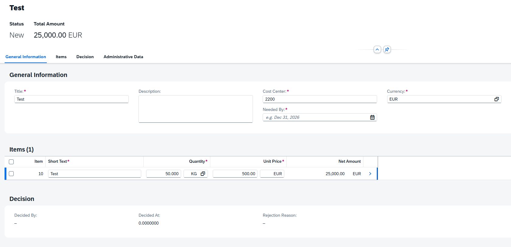
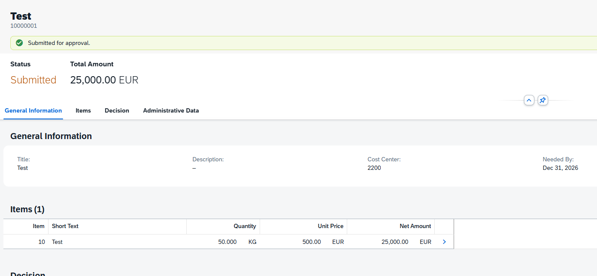
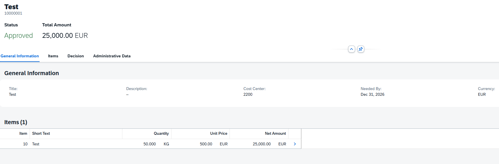
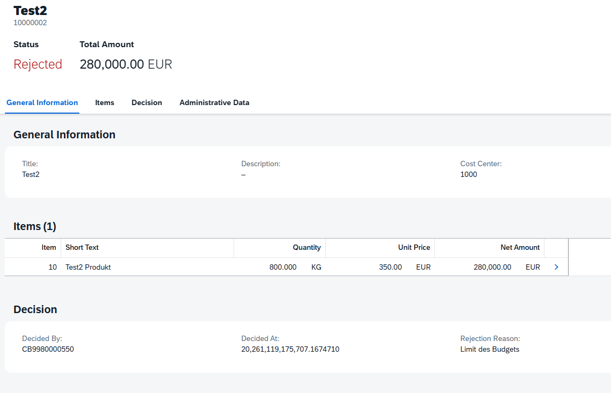
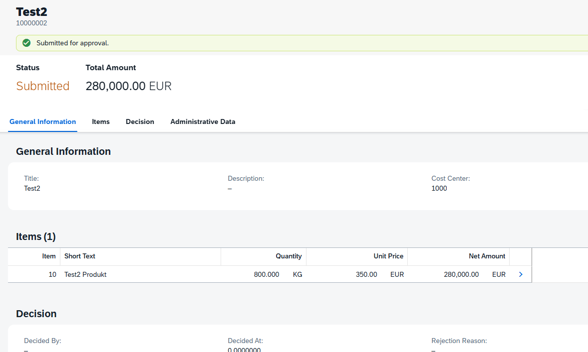
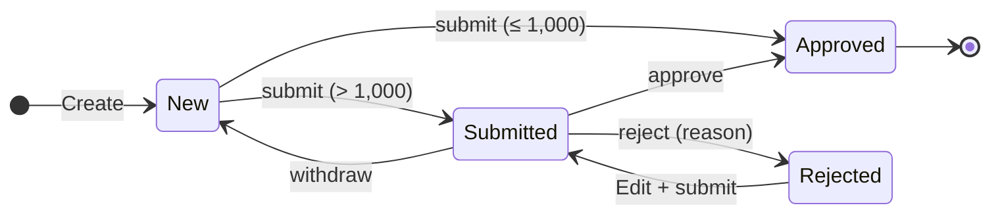
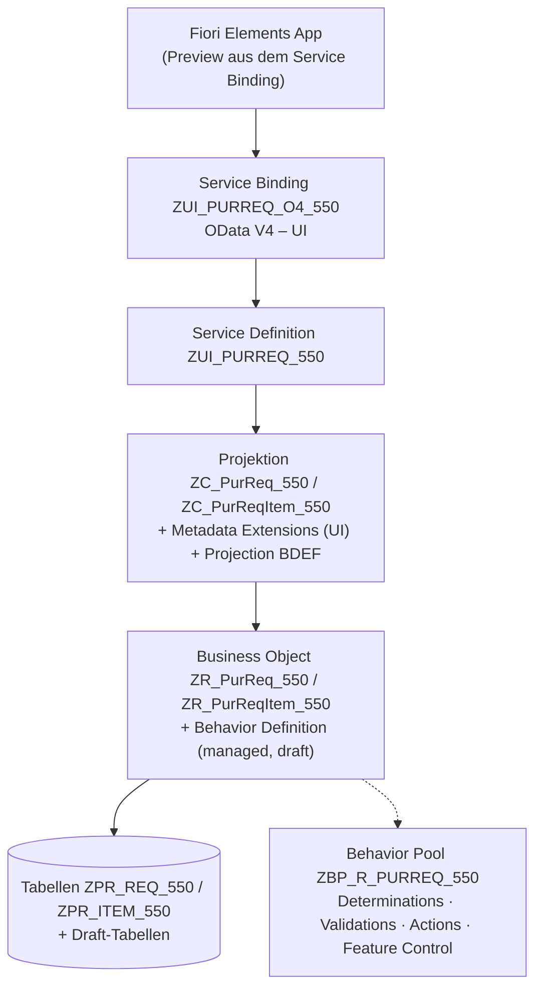

# Bestellanforderung mit Freigabeprozess – ABAP RAP

**ABAP Cloud · RAP (managed, mit Draft) · CDS View Entities · EML · Fiori Elements · OData V4**

[](https://github.com/macleodc708/sap-rap-purchase-requisition/actions/workflows/abaplint.yml)

Dieselbe Geschäftsanwendung wie in meinem CAP-Projekt
[sap-cap-purchase-requisition](https://github.com/macleodc708/sap-cap-purchase-requisition),
diesmal umgesetzt mit dem **ABAP RESTful Application Programming Model (RAP)** in **ABAP Cloud**.
Das ist der Standard für Entwicklungen in SAP S/4HANA und auf der SAP BTP (ABAP Environment, „Steampunk“).

> *English summary:* Purchase requisition with an approval workflow built as a managed RAP business object with draft
> in ABAP Cloud: CDS view entities, behavior definition with determinations, validations, actions with parameters,
> instance feature control, side effects, virtual elements and a Fiori elements UI via OData V4.
> The same process is also implemented in SAP CAP, see the comparison below.



---

## Screenshots aus dem SAP BTP ABAP Environment

| | |
|---|---|
| **Eingereicht**: über 1.000 → Status „Submitted“ | **Freigegeben** |
|  |  |
| **Abgelehnt** mit Begründung | **Weitere Anforderung** (280.000 EUR) |
|  |  |

## Funktionen

| Bereich | Umsetzung in RAP |
|---|---|
| **Draft** | `with draft`, Entwurfstabellen, `draft determine action Prepare` |
| **Nummernvergabe** | BANF-Nummer ab 10000001 (`determination setReqID on save`), Positionen 10, 20, 30 … (`setItemDefaults`) |
| **Berechnungen** | Nettowert je Position, Gesamtwert am Kopf über eine interne Aktion (`recalcTotal`), live in der Oberfläche über **Side Effects** |
| **Prüfungen** | „Benötigt bis“ nicht in der Vergangenheit, Menge > 0 (`validation … on save`), Pflichtfelder über `field ( mandatory )` |
| **Freigabeprozess** | Aktionen `submit`, `withdraw`, `approve`, `reject` (mit Parameter über eine Abstract Entity) |
| **Freigabestrategie** | Bis 1.000 automatisch freigegeben, darüber Status „Submitted“. Vier-Augen-Prinzip optional (siehe unten). |
| **Statussteuerung** | **Instance Feature Control**: Bearbeiten, Löschen, Positionen und Aktionen werden je Status aktiviert oder deaktiviert. |
| **Statustext und Farbe** | **Virtual Elements** (`ZCL_PURREQ_VIRT_550`), funktioniert auch im Entwurf |
| **Oberfläche** | Fiori Elements (List Report + Object Page), komplett über **Metadata Extensions** beschrieben |

## Status-Ablauf



## Architektur (RAP-Schichten)



## Objektübersicht

| Objekt | Typ | Zweck |
|---|---|---|
| `ZPR_REQ_550`, `ZPR_ITEM_550` | Tabellen | Kopf und Positionen |
| `ZPR_REQ_D_550`, `ZPR_ITEM_D_550` | Tabellen | Entwürfe (Draft) |
| `ZR_PurReq_550`, `ZR_PurReqItem_550` | CDS View Entities | Datenmodell des Business Objects |
| `ZC_PurReq_550`, `ZC_PurReqItem_550` | CDS Projection Views | Projektion für die Oberfläche |
| `ZD_RejectReason_550` | Abstract Entity | Parameter der Aktion „Reject“ |
| `ZR_PurReq_550`, `ZC_PurReq_550` | Behavior Definitions | Verhalten des Business Objects und der Projektion |
| `ZBP_R_PURREQ_550` | Klasse | Behavior Pool mit der Geschäftslogik |
| `ZCL_PURREQ_VIRT_550` | Klasse | Virtual Elements (Statustext, Kritikalität) |
| `ZC_PurReq_550`, `ZC_PurReqItem_550` | Metadata Extensions | UI-Annotationen |
| `ZUI_PURREQ_550` | Service Definition | Welche Entitäten der Service anbietet |
| `ZUI_PURREQ_O4_550` | Service Binding | OData V4 für Fiori |

Das Suffix `_550` sorgt für eindeutige Namen im gemeinsam genutzten SAP-BTP-Trial-System.

## CAP oder RAP? Derselbe Prozess, zwei Technologien

| | **SAP CAP** ([Projekt](https://github.com/macleodc708/sap-cap-purchase-requisition)) | **ABAP RAP** (dieses Projekt) |
|---|---|---|
| Sprache | CDS + JavaScript/TypeScript (oder Java) | CDS + ABAP |
| Läuft auf | SAP BTP (Cloud Foundry, Kyma), überall wo Node.js läuft | ABAP-System: S/4HANA, BTP ABAP Environment |
| Datenmodell | CDS-Entitäten, Datenbank wird generiert | DDIC-Tabellen + CDS View Entities |
| Geschäftslogik | Event-Handler (`before`/`on`/`after`) | Behavior Definition + Behavior Pool (Determinations, Validations, Actions) |
| Draft | `@odata.draft.enabled` | `with draft` + Draft-Tabellen |
| Statussteuerung | `@Core.OperationAvailable` | Instance Feature Control |
| Lokal entwickeln | ja, mit SQLite und Mocks | nein, braucht ein ABAP-System |
| Typischer Einsatz | Side-by-Side-Erweiterungen, neue Cloud-Apps, Integration | Erweiterungen im S/4HANA-Kern (On-Stack), ABAP-Know-how im Team |

**Faustregel:** Liegen die Daten und Prozesse im S/4HANA-System und gibt es ABAP-Know-how im Team, dann RAP.
Handelt es sich um eine eigenständige Cloud-App, mehrere Systeme oder ein Team mit Node.js-/Java-Erfahrung, dann CAP.

## Installation im SAP BTP ABAP Environment (Trial)

Voraussetzungen: SAP BTP Trial mit ABAP Environment, Eclipse mit den **ABAP Development Tools** und ein verbundenes **ABAP Cloud Project**.

1. **Paket anlegen:** Rechtsklick auf `ZLOCAL` → *New* → *ABAP Package*
   - Name: `ZPR_RAP_550`, Beschreibung: „Purchase Requisition RAP“
   - Superpackage `ZLOCAL`, Software Component `ZLOCAL`, **kein Transportauftrag**
2. **abapGit-Ansicht öffnen:** *Window* → *Show View* → *Other…* → **abapGit Repositories**
3. **Repository verknüpfen:** In der Ansicht auf das grüne **+** („Link New abapGit Repository“) klicken.
   - URL: `https://github.com/macleodc708/sap-rap-purchase-requisition.git`
   - Branch: `main`, Package: `ZPR_RAP_550`
   - **„Pull after link“** anhaken und auf *Finish* klicken
4. **Aktivieren:** Nach dem Pull fragt Eclipse, welche Objekte aktiviert werden sollen. Alle auswählen und aktivieren.
   Bei Fehlern kann auch ein zweiter Durchgang mit *Activate inactive objects* (`Strg + Umschalt + F3`) helfen.
5. **Service veröffentlichen:** Service Binding `ZUI_PURREQ_O4_550` öffnen und auf **Publish** klicken.
   - Meldung *„Inbound service ZUI_PURREQ_O4_550_0001_… does not exist“*? Das ist ein bekanntes Verhalten bei per abapGit
     importierten Service Bindings. Abhilfe: Binding löschen, dann Rechtsklick auf die Service Definition `ZUI_PURREQ_550` →
     *New Service Binding* → Name `ZUI_PURREQ_O4_550`, Typ **OData V4 – UI** → aktivieren → *Publish*.
6. **App testen:** Im Service Binding die Entität `PurchaseRequisition` auswählen und auf **Preview** klicken.

### Hinweis zu Mengeneinheiten im Trial-System

Im gemeinsam genutzten Trial-System sind nicht alle Mengeneinheiten vollständig eingerichtet. Bei `PC` (Stück) erscheint
z. B. *„No configuration for unit of measure 'PC'“*. Für Tests eignen sich Einheiten wie `KG`, `M` oder `L`.

### Vier-Augen-Prinzip einschalten

Im Trial-System gibt es nur einen Benutzer. Deshalb ist die Prüfung „niemand entscheidet über seine eigene Anforderung“
standardmäßig ausgeschaltet, damit man den Prozess vorführen kann. Einschalten in `ZBP_R_PURREQ_550`:

```abap
CONSTANTS four_eyes_check_active TYPE abap_bool VALUE abap_true.
```

## Qualitätssicherung

- **abaplint** prüft bei jedem Push ABAP-Syntax, CDS-Syntax und die Konsistenz der abapGit-Dateien (GitHub Actions).
- Grenzen: abaplint prüft **nicht**, ob die Feldnamen in den EML-Anweisungen (`READ ENTITIES …`) zum CDS-Modell passen.
  Das übernimmt die Aktivierung im ABAP-System.

## Bewusste Vereinfachungen und nächste Schritte

- **Berechtigungen:** zurzeit „alles erlaubt“. Produktiv kämen ein Berechtigungsobjekt und `AUTHORITY-CHECK` dazu, z. B. je Kostenstelle, sowie Rollen für Anforderer, Genehmiger und Einkaufsleitung.
- **Nummernvergabe** über ein Nummernkreisobjekt (`cl_numberrange_runtime`) statt `MAX() + 1`
- **Meldungen** über eine Nachrichtenklasse (mehrsprachig) statt fester englischer Texte
- **ABAP Unit Tests** mit EML-Testdoubles (`cl_botd_txbufdbl_bo_test_env`)
- Gesamtwert wird beim Löschen einer Position erst beim nächsten Ändern bzw. Einreichen neu berechnet

## Hinweise

- Die Dateiformate (abapGit) orientieren sich an SAPs Referenzszenario
  [SAP-samples/abap-platform-refscen-flight](https://github.com/SAP-samples/abap-platform-refscen-flight) (Apache-2.0).
- Entwickelt mit Unterstützung von KI (Claude von Anthropic).

## Lizenz

[MIT](LICENSE)
